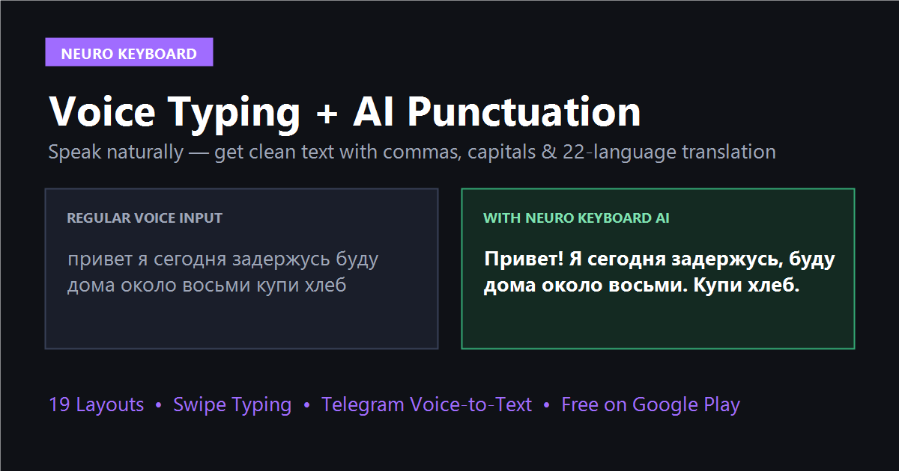

# 🎙 Neuro Keyboard — AI Voice Typing, Punctuation & Translator for Android

**Neuro Keyboard** (**Нейро-Клавиатура** / **Нейро-Клавіатура**) is a fast, privacy-focused Android keyboard built around **ChatGPT-grade voice dictation (Gemini + Whisper)** with **automatic AI punctuation** that preserves your exact wording.

## ✨ Highlights (v1.68)
- **Voice Typing with AI Punctuation:** Speak naturally (even in a whisper or noisy car) and get clean text with commas, periods, question marks, and capitals — without robotic rewrites.
- **Share-to-Transcribe Voice & Video Notes:** Share any voice message or round Telegram video note (`video/mp4`) from WhatsApp, Telegram, or Viber to **Neuro Keyboard** for instant text + AI summary.
- **In-Keyboard AI Translator (22 Languages):** Type or dictate in your language and send in English, German, Polish, Spanish, Ukrainian, Russian, Turkish, and more.
- **19 Keyboard Layouts & UI Languages:** `EN, UK, RU, PL, DE (QWERTZ), FR (AZERTY), ES, IT, PT, TR, ID, NL, RO, CS, SK, HU, SV, FI, DA`.
- **Elastic Swipe Typing & Personal Dictionary:** Tuned on real human glide gestures; remembers your names and slang so autocorrect never fights you.
- **Privacy First:** Normal keystrokes, suggestions, and swipe decoding stay **100% on your device**.

## 🌐 Available in 19 Languages
- 🇬🇧 [English](https://pauduke61-ship-it.github.io/neuro-keyboard/) · 🇺🇦 [Українська](https://pauduke61-ship-it.github.io/neuro-keyboard/uk/) · 🇷🇺 [Русский](https://pauduke61-ship-it.github.io/neuro-keyboard/ru/) · 🇵🇱 [Polski](https://pauduke61-ship-it.github.io/neuro-keyboard/pl/) · 🇩🇪 [Deutsch](https://pauduke61-ship-it.github.io/neuro-keyboard/de/) · 🇪🇸 [Español](https://pauduke61-ship-it.github.io/neuro-keyboard/es/) · 🇫🇷 [Français](https://pauduke61-ship-it.github.io/neuro-keyboard/fr/) · 🇮🇹 [Italiano](https://pauduke61-ship-it.github.io/neuro-keyboard/it/) · 🇧🇷 [Português](https://pauduke61-ship-it.github.io/neuro-keyboard/pt/) · 🇹🇷 [Türkçe](https://pauduke61-ship-it.github.io/neuro-keyboard/tr/) · 🇮🇩 [Indonesia](https://pauduke61-ship-it.github.io/neuro-keyboard/id/)

## 📥 Download
1. **Google Play (Recommended, auto-updates):** [Get Neuro Keyboard on Google Play](https://play.google.com/store/apps/details?id=com.neurokb.app&referrer=utm_source%3Dgithub_readme%26utm_medium%3Dweb%26utm_campaign%3Drepo)
2. **Direct Signed APK:** [Download from Releases](https://github.com/pauduke61-ship-it/neuro-keyboard/releases/latest)
3. **Free Telegram Voice-to-Text Bot:** [@NeuroKeyboard_AI](https://t.me/NeuroKeyboard_AI)
